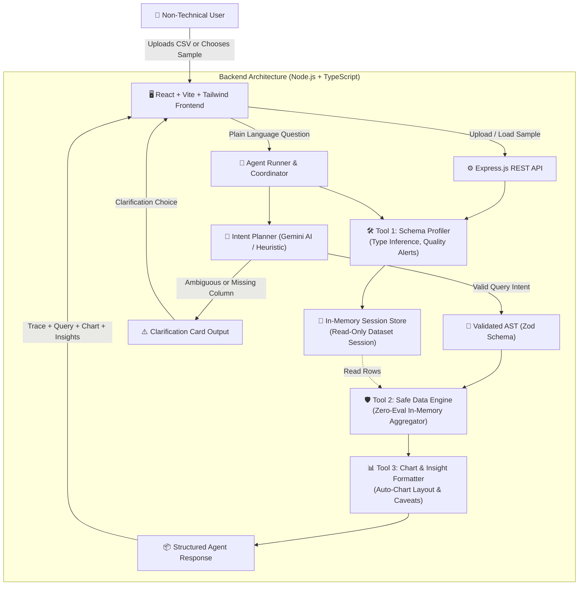

# AskMyData 📊🤖
### AI Data & Analytics Agent for Plain-Language CSV Analysis
**Hackathon Theme:** Theme 9 — Data & Analytics Agents  
**Target Users:** Business teams, operations leads, and data consumers who need to understand their data but do not know SQL.  
**Live Production URL:** [https://askmydata-ai.vercel.app/](https://askmydata-ai.vercel.app/)  
**GitHub Repository:** [https://github.com/mamillaramcharan2174/askmyname](https://github.com/mamillaramcharan2174/askmyname)

---

## 📌 Problem Statement & Solution

### The Problem
In modern organizations, business teams rely heavily on dedicated data analysts to answer basic, repetitive questions about tabular spreadsheets and CSV exports (e.g., *"Which product had the highest sales last quarter?"*, *"What was our average order value by region?"*). This creates multi-day bottlenecks for business teams and distracts analysts from high-leverage modeling. Existing AI chatbots frequently hallucinate numbers, write arbitrary code (`eval()`, python scripts) that exposes servers to security vulnerabilities, or fail silently on ambiguous user requests.

### The Solution
**AskMyData** is an autonomous, read-only analytics agent built specifically for non-technical users. It accepts CSV uploads or instant sample datasets, automatically profiles schemas and data quality warnings, translates plain-language questions into an **allowlisted, zero-eval Abstract Syntax Tree (AST)** query, executes the calculation safely against the dataset in memory, and presents the result alongside an interactive chart, a step-by-step agent trace, and plain-language insights. If a question is ambiguous or requests columns that do not exist, the agent asks a structured clarification question rather than silently guessing.

---

## ✨ Key Features

1. **Self-Service CSV Ingestion & Profiling:**
   - Drag-and-drop CSV upload (up to 10MB, up to 50,000 rows).
   - In-memory processing: CSV data is never written to arbitrary external databases or modified.
   - Immediate schema profiling: Inferred data types (`number`, `string`, `date`, `boolean`), null counts & percentages, unique cardinalities, min/max ranges, and data quality warnings.

2. **Plain-Language Analytics Q&A:**
   - Understands business questions (e.g. *"Which product had the highest sales last quarter?"*, *"Compare average profit by country"*, *"Show total revenue by region"*).
   - Translates questions into structured AST instructions validated strictly with **Zod**.

3. **Ambiguity Guardrails & Clarification Prompts:**
   - Detects underspecified queries (e.g. *"Show performance summary"*) or requests for missing attributes (e.g. *"What is the employee salary?"* on a sales CSV).
   - Halts and prompts the user with specific clarification questions and 2–3 one-click resolution cards.

4. **Zero-Eval, Allowlisted Read-Only Query Engine:**
   - Never generates or executes arbitrary SQL, JavaScript, Python, or shell code.
   - Evaluates queries through a deterministic AST processor supporting allowlisted operators (`=`, `!=`, `>`, `<`, `>=`, `<=`, `contains`, `in`, `is_null`, `not_null`) and aggregations (`count`, `sum`, `avg`, `min`, `max`).
   - Generates and displays readable Pseudo-SQL alongside the raw AST JSON for complete auditability.

5. **Visible Step-by-Step Execution Trace:**
   - Shows real-time agent execution pipeline with timing in milliseconds (`ms`), status badges, and expandable tool input/output observation payloads:
     - Step 1: `schema_profiler`
     - Step 2: `intent_planner`
     - Step 3: `safe_data_engine`
     - Step 4: `chart_result_formatter`

6. **Automated Visualization & Executive Insights:**
   - Intelligent chart selection: Bar charts for category comparisons, Line/Area charts for temporal trends, Pie charts for distributions, or Data Tables for projections.
   - Business insights with highlighted top performers, totals, and clear data caveats (active filters, matched rows, missing value exclusions).
   - One-click CSV export of computed aggregation results.

7. **Context-Aware Conversational Follow-Ups:**
   - Preserves query context within user sessions for chained queries (e.g. *"Now break that down by region"*).

8. **Dual-Mode Architecture (Gemini Live AI + Local Deterministic Demo Mode):**
   - Seamlessly uses **Google Gemini API** (`gemini-1.5-flash` or `gemini-2.0-flash`) when an API key is provided.
   - Features a 100% offline, deterministic heuristic agent that works out-of-the-box with bundled sample datasets when no API key is configured.

---

## 🏗️ System Architecture



### Architectural Flow:
1. **Ingestion & Profiling:** PapaParse streams the CSV into memory. `schema_profiler` inspects each column, infers types, counts nulls, and warns about anomalies.
2. **Intent Planning:** When the user enters a question, `intent_planner` evaluates the query against the profiled schema. If ambiguous, it triggers a `ClarificationPrompt`. Otherwise, it emits a validated `AnalysisQuery` AST.
3. **Safe Execution:** `safe_data_engine` filters, groups, aggregates, and sorts the rows using allowlisted mathematical operations without calling `eval()` or running raw SQL.
4. **Result Formatting:** `chart_result_formatter` selects the chart type (`bar`, `line`, `area`, `pie`, `table`), assigns color schemes, summarizes findings, and notes data caveats.
5. **UI Rendering:** The client displays the result in four synchronized panels: Executive Insights, Dynamic Chart & Table, Validated Query/AST, and Execution Trace.

---

## 🛠️ Tools & Input/Output Specifications

AskMyData implements four dedicated, strongly-typed tools on the backend:

| Tool Name | Purpose | Input Schema | Output Schema |
|---|---|---|---|
| **`schema_profiler`** | Analyzes column headers, types, and quality warnings | `{ datasetId: string, filename: string, rows: Record<string, any>[] }` | `DatasetProfile` (column types, null counts, cardinalities, sample values, quality issues) |
| **`intent_planner`** | Translates natural language into structured AST instructions | `{ question: string, profile: DatasetProfile, previousQuery?: AnalysisQuery }` | `{ isAmbiguous: boolean, plan: string[], queryAst?: AnalysisQuery, clarification?: ClarificationPrompt }` |
| **`safe_data_engine`** | Safely filters, groups, aggregates, and sorts records in memory | `{ query: AnalysisQuery, columns: ColumnProfile[], rows: Record<string, any>[] }` | `{ results: Record<string, any>[], pseudoSql: string, totalMatchedRows: number, outputRowsCount: number, executionTimeMs: number }` |
| **`chart_result_formatter`** | Selects optimal visualization and writes plain-language insights | `{ question: string, queryAst: AnalysisQuery, results: Record<string, any>[], columns: ColumnProfile[], totalMatchedRows: number }` | `{ chartConfig: ChartConfig, insight: InsightSummary, suggestedFollowUps: string[] }` |

---

## 🔒 Data Safety & Security Approach

- **Untrusted File Handling:** Uploaded CSVs are parsed strictly as structured text. Text values are escaped and never evaluated as executable code.
- **Zero Arbitrary Execution:** No arbitrary SQL, Python, JavaScript (`eval`), or shell commands are executed. Calculations only occur through allowlisted AST operators:
  - Allowed comparison operators: `=`, `!=`, `>`, `<`, `>=`, `<=`, `contains`, `starts_with`, `ends_with`, `in`, `not_in`, `is_null`, `not_null`.
  - Allowed aggregations: `count`, `sum`, `avg`, `min`, `max` (`sum` and `avg` only permitted on validated numeric columns).
- **Privacy First:** Full dataset cell contents are never transmitted to external AI providers. Only column names, inferred types, and 2–3 sample values are sent to LLMs for question interpretation. All mathematical aggregations occur locally on the server.
- **Read-Only In-Memory Storage:** The session store holds datasets in memory for the duration of the user session. Datasets are strictly read-only; no write, update, or drop mutations exist.

---

## 📋 Hackathon Theme Checklist (Theme 9: Data & Analytics Agents)

- [x] **Accepts CSV upload:** Supports drag-and-drop file upload with size validation.
- [x] **Previews data & schema:** Displays row counts, inferred types, null counts, and import issues.
- [x] **Sample datasets included:** Pre-bundled with `Tech Sales 2024` (140 rows) and `E-Commerce Orders` (100 rows).
- [x] **Plain-language questions:** Interprets business queries like *"Which product had the highest sales last quarter?"*.
- [x] **Ambiguity detection & clarification:** Asks specific clarification questions instead of silently guessing.
- [x] **Safe query generation & execution:** Zero-eval read-only AST executor with allowlisted operators.
- [x] **Shows query & calculation used:** Displays readable Pseudo-SQL and inspectable AST JSON.
- [x] **Visual charts & results table:** Interactive Recharts (Bar, Line, Area, Pie, Table) with CSV export.
- [x] **Plain-language explanations & caveats:** Executive summary, key findings, and data scope limitations.
- [x] **Step-by-step trace in UI:** Shows each step, tool used, status, execution duration in `ms`, and inspectable I/O.
- [x] **Conversational follow-ups:** Supports context-aware chained questions (e.g. *"Now by region"*).
- [x] **Demo mode with fallback:** Seamless local demo mode operates autonomously even if no AI API key is configured.

---

## 💻 Tech Stack

- **Frontend:** React 18, Vite 6, TypeScript, Tailwind CSS, Recharts, Lucide React.
- **Backend:** Node.js, Express, TypeScript, Zod, PapaParse, Multer.
- **AI Integration:** Google Generative AI SDK (`@google/generative-ai` for Gemini 1.5 Flash / 2.0 Flash) + Local Deterministic Heuristic Engine.
- **Tooling:** tsx, Concurrent monorepo orchestration.

---

## 🚀 Local Setup & Execution Guide

### Prerequisites
- Node.js version 18 or higher (`node --version`)
- npm version 9 or higher (`npm --version`)

### 1. Installation
Clone or navigate to the project directory:
```bash
cd askmydata
```

Install root, backend, and frontend dependencies:
```bash
npm run install:all
```
*(Or install in each directory individually: `npm install && cd server && npm install && cd ../client && npm install`)*

### 2. Environment Configuration
Copy `.env.example` to `server/.env`:
```bash
cp .env.example server/.env
```

Open `server/.env` and optionally set your Google Gemini API key:
```env
PORT=4000
NODE_ENV=development
GEMINI_API_KEY=your_gemini_api_key_here
GEMINI_MODEL=gemini-1.5-flash
```
> **Note:** If `GEMINI_API_KEY` is omitted, AskMyData automatically starts in **Autonomous Local Demo Mode**, enabling full evaluation of all features without any API key or external network dependency!

### 3. Run Development Servers
Start both backend (port 4000) and frontend (port 5173) simultaneously:
```bash
npm run dev
```

Open your browser to:
```
http://localhost:5173
```

### 4. Build for Production
To build production artifacts for both frontend and backend:
```bash
npm run build
```

### 5. Run Automated End-to-End Tests
To verify all 32 automated unit and integration tests:
```bash
cd server
npm test
```
*(Or run `npx tsx src/test-e2e.ts`)*

---

## 🎬 3–5 Minute Demo Script for Judges

Follow this step-by-step walkthrough to demonstrate the full capabilities of AskMyData during a 3–5 minute presentation:

### Step 1: Open Sample Dataset (30 seconds)
1. Launch the application at `http://localhost:5173`.
2. Notice the top navigation bar showing `Theme 9: Data & Analytics Agent` and the current runtime mode badge (`Autonomous Local Demo Mode` or `Google Gemini AI`).
3. Click the **"Tech Sales 2024"** sample dataset card (or upload your own CSV).
4. Point out the **Dataset Summary & Schema Profiler**:
   - Total rows: `140`, Total columns: `12`.
   - Inferred types: `Date` (date), `Product_Category` (string), `Revenue` (number), etc.
   - Quality notice: highlights column distributions and null percentages.

### Step 2: Ask Primary Plain-Language Question (60 seconds)
1. Click the suggested prompt pill:  
   **`"Which product had the highest sales last quarter?"`**  
   *(or type it in the search bar and press Enter)*.
2. Watch the analysis generate in under 50ms:
   - **Executive Insights:** *"Based on the uploaded dataset, AI Platform yielded the highest Sum Revenue ($168,000.00)."*
   - **Visual Chart:** Displays a responsive Bar Chart comparing `AI Platform`, `Analytics Suite`, `Cybersecurity`, `Cloud Infrastructure`, and `DevOps Tools`.
   - **Data Caveats:** Explains that the calculation filtered for `Quarter = 'Q4'` across 35 matching records.

### Step 3: Inspect Safe Query & Execution Trace (45 seconds)
1. Scroll to the **Safe Query & Calculation Panel**:
   - Toggle between **Pseudo-SQL** and **Safe AST JSON**.
   - Show that no arbitrary code was executed; the query is a clean, validated aggregation AST.
2. Open the **Agent Execution Trace**:
   - Highlight the 4 step pipeline: `schema_profiler`, `intent_planner`, `safe_data_engine`, and `chart_result_formatter`.
   - Click any step to expand its tool inputs and outputs.

### Step 4: Demonstrate Ambiguity Guardrail (45 seconds)
1. Click the starter prompt pill: **`"Show performance summary"`**.
2. Point out that the agent **does not silently guess** what "performance" means.
3. The **Clarification Needed Card** appears:
   - Explains: *"The question is general and does not specify which metric or dimension to evaluate."*
   - Offers 3 clear options:
     - *"Total Revenue by Region"*
     - *"Average Customer Satisfaction by Customer Segment"*
     - *"Top 5 records by Revenue"*
4. Click **"Total Revenue by Region"**: The agent immediately runs the clarified query and renders the regional breakdown chart!

### Step 5: Test Missing Column Guardrail (30 seconds)
1. In the search box, enter an impossible query:  
   **`"What is the average employee salary by department?"`**
2. Show that the agent validates every column against the dataset schema:
   - It pauses and states: *"The dataset does not contain any column related to 'salary'. Available columns are: Order_ID, Date, Quarter, Region, Product_Category, Revenue..."*
   - It provides suggestions using valid numeric columns.

### Step 6: Conversational Follow-Up (30 seconds)
1. After reviewing regional revenue, enter the follow-up prompt:  
   **`"Now break that down by customer segment"`**.
2. Notice how the agent retains prior conversation context and updates the grouping accordingly.
3. Open the **Session History Drawer** from the top navbar to show that all queries are preserved for one-click recall.

---

## 📋 Hackathon Submission Form Copy-Paste Blocks

### 1. Concise Problem Statement (Ready to paste):
> Non-technical business users frequently need quick answers from tabular CSV datasets, but lack SQL knowledge and must wait on backlogged analysts. Meanwhile, generic AI chatbots frequently hallucinate numbers, risk security breaches by executing unconstrained code (`eval()`, python scripts), and fail silently when users ask ambiguous questions.

### 2. Concise Solution Description (Ready to paste):
> AskMyData is an autonomous, read-only analytics agent for non-technical users. It accepts CSV uploads, infers strict data schemas, and translates plain-language questions into safe, allowlisted AST aggregations validated with Zod. The agent executes calculations in memory without arbitrary code execution, returns interactive charts with plain-language business insights, and proactively asks structured clarification questions when queries are ambiguous or reference missing data.

---

## 🌐 Deploying to Render (render.com)

AskMyData is fully prepared for one-click deployment on **Render** as a unified full-stack Node.js Web Service or Docker container.

### Option A: Deploy via Render Blueprint (render.yaml)
1. Push this project to your GitHub or GitLab repository.
2. In the [Render Dashboard](https://dashboard.render.com/), click **New +** ➔ **Blueprint**.
3. Select your repository. Render will automatically read [`render.yaml`](./render.yaml).
4. Configure your environment variables when prompted:
   - `NODE_ENV`: `production`
   - `PORT`: `10000`
   - `SUPABASE_URL`: `https://your-project.supabase.co`
   - `SUPABASE_ANON_KEY`: `your_anon_key`
   - `GEMINI_API_KEY`: *(optional for live LLM, or omit for autonomous demo mode)*
5. Click **Apply** — Render builds the client, compiles the backend, and deploys the unified app at `https://askmydata.onrender.com`.

### Option B: Manual Web Service Setup on Render
1. In Render Dashboard, click **New +** ➔ **Web Service**.
2. Connect your Git repository.
3. Configure the service settings:
   - **Environment:** `Node`
   - **Branch:** `main`
   - **Build Command:** `npm run install:all && npm run build`
   - **Start Command:** `npm start`
   - **Health Check Path:** `/api/health`
4. Under **Environment Variables**, add:
   - `NODE_ENV` = `production`
   - `PORT` = `10000`
   - `SUPABASE_URL` = your Supabase URL
   - `SUPABASE_ANON_KEY` = your Supabase Anon key
5. Click **Create Web Service**.

### Option C: Deploy via Docker
Use the included production-grade [`Dockerfile`](./Dockerfile):
1. In Render Dashboard, choose **Docker** as the environment.
2. Render will automatically build the multi-stage image and expose the service on port `10000`.

